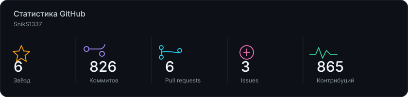

<h1 align="center">SnikS1337 / developer</h1>

  

  

  

  
  
  

  <picture>
    <source media="(prefers-color-scheme: dark)" srcset="https://raw.githubusercontent.com/SnikS1337/SnikS1337/output/github-contribution-grid-snake-dark.svg" />
    <source media="(prefers-color-scheme: light)" srcset="https://raw.githubusercontent.com/SnikS1337/SnikS1337/output/github-contribution-grid-snake.svg" />
    
  </picture>

## Recent projects

1. [beamng-mod-manager](https://github.com/SnikS1337/beamng-mod-manager) — Rust · Svelte · Tauri
2. [finance-tracker](https://github.com/SnikS1337/finance-tracker) — TypeScript
3. [Qa-Trainer](https://github.com/SnikS1337/Qa-Trainer) — TypeScript
4. [Simple-ATM-on-REST](https://github.com/SnikS1337/Simple-ATM-on-REST) — Go
